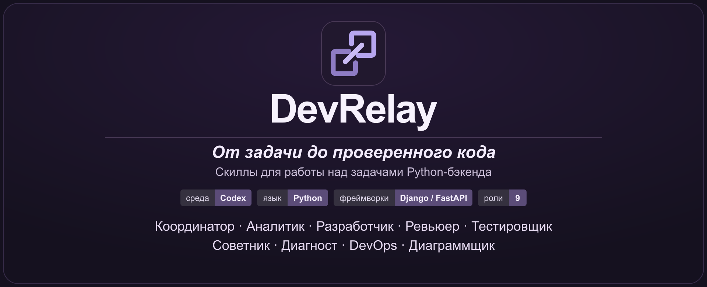

# DevRelay



DevRelay помогает провести задачу через анализ, разработку, независимое ревью и тестирование. Передай координатору тикет или вызови отдельную роль, например ревьюера для текущего diff.

**Первая версия сделана для Codex.** Сейчас доступен комплект Python со справочниками для Django, Django REST Framework и FastAPI. Дальше планирую адаптировать скиллы для других ассистентов и добавлять комплекты для других языков и фреймворков.

## Подключение к Codex

Понадобятся Git и Codex CLI или расширение Codex для IDE. Роли подключаются для текущего пользователя и доступны в разных проектах. [Как Codex находит локальные скиллы](https://developers.openai.com/codex/skills/)

### 1. Скачай репозиторий

Если репозиторий уже скачан, открой терминал в его корне и переходи к шагу 2.

```sh
git clone https://github.com/itsrealnode/DevRelay.git
cd DevRelay
```

Оставь папку DevRelay на месте после подключения. По ссылкам Codex будет открывать скиллы и их справочники.

### 2. Подключи скиллы для своей ОС

#### macOS и Linux

Выполни в Bash или Zsh из корня DevRelay. При повторном запуске блок добавит недостающие ссылки.

```sh
repo_dir="$(pwd -P)"
skills_dir="$HOME/.agents/skills"
mkdir -p "$skills_dir"

for skill in "$repo_dir"/skills/devrelay "$repo_dir"/languages/python/skills/devrelay-python*; do
  [ -f "$skill/SKILL.md" ] || continue
  link="$skills_dir/${skill##*/}"
  if [ -e "$link" ] || [ -L "$link" ]; then
    [ "$link" -ef "$skill" ] || printf 'Имя уже занято: %s\n' "$link"
    continue
  fi
  ln -s "$skill" "$link"
done
```

#### Windows

Открой PowerShell в корне DevRelay на диске NTFS. Блок создаёт ссылки типа `Junction`. Если запускаешь Codex внутри WSL, используй инструкции для Linux. [Синтаксис New-Item](https://learn.microsoft.com/powershell/module/microsoft.powershell.management/new-item)

```powershell
$skillsDir = Join-Path $HOME '.agents\skills'
New-Item -ItemType Directory -Path $skillsDir -Force | Out-Null

$skills = @(Get-Item -LiteralPath '.\skills\devrelay') +
    @(Get-ChildItem -LiteralPath '.\languages\python\skills' -Directory -Filter 'devrelay-python*')

foreach ($skill in $skills) {
    if (!(Test-Path -LiteralPath (Join-Path $skill.FullName 'SKILL.md'))) { continue }
    $link = Join-Path $skillsDir $skill.Name
    $existing = Get-Item -LiteralPath $link -Force -ErrorAction SilentlyContinue
    if ($existing) {
        if ($existing.Target -notcontains $skill.FullName) {
            Write-Warning "Имя уже занято: $link"
        }
        continue
    }
    New-Item -ItemType Junction -Path $link -Target $skill.FullName | Out-Null
}
```

### 3. Проверь подключение

Открой свой Python-проект в новом чате Codex. В CLI введи `/skills`, а в расширении IDE набери `$` и начни вводить `devrelay`. Должны появиться общий вход `$devrelay`, координатор Python `$devrelay-python` и восемь специализированных ролей.

Попробуй запрос, который проверяет подключение без изменений в проекте.

```text
$devrelay-python-analyst Найди один HTTP-обработчик и проследи его до места чтения или записи данных. Укажи файлы и функции.
```

Если скилл не появился, проверь, что ссылка в `.agents/skills` открывает папку с `SKILL.md`. При сообщении «Имя уже занято» проверь, на какую копию указывает существующая ссылка.

### Обновление

В корне DevRelay выполни `git pull --ff-only`. Если добавились новые роли, повтори шаг подключения.

## Какую роль вызвать

| Скилл | Когда использовать |
|---|---|
| [$devrelay](skills/devrelay/SKILL.md) | Подобрать комплект для языка задачи и провести её через нужные этапы. |
| [$devrelay-python](languages/python/skills/devrelay-python/SKILL.md) | Провести задачу Python целиком, от сверки требований до проверки реализации. |
| [$devrelay-python-analyst](languages/python/skills/devrelay-python-analyst/SKILL.md) | Сверить постановку с текущим кодом и сформулировать критерии приёмки. |
| [$devrelay-python-development](languages/python/skills/devrelay-python-development/SKILL.md) | Подготовить план или реализовать согласованную задачу. |
| [$devrelay-python-reviewer](languages/python/skills/devrelay-python-reviewer/SKILL.md) | Проверить diff или PR и объяснить, когда замечание влияет на результат. |
| [$devrelay-python-tester](languages/python/skills/devrelay-python-tester/SKILL.md) | Проверить поведение по требованиям и воспроизвести дефект тестом. |
| [$devrelay-python-advisor](languages/python/skills/devrelay-python-advisor/SKILL.md) | Сравнить варианты технического решения. |
| [$devrelay-python-diagnostician](languages/python/skills/devrelay-python-diagnostician/SKILL.md) | Разобрать сбой по коду и логам и проверить его предполагаемую причину. |
| [$devrelay-python-devops](languages/python/skills/devrelay-python-devops/SKILL.md) | Выяснить, что требуется процессу при запуске и выкладке. |
| [$devrelay-python-diagrammer](languages/python/skills/devrelay-python-diagrammer/SKILL.md) | Показать вызовы, состояния или связи компонентов, при необходимости подготовить SVG или PNG. |

## Примеры запросов

```text
$devrelay Добавь повторную доставку уведомлений. Сначала покажи план и дождись согласования.

$devrelay-python-reviewer Проверь текущий diff. Что произойдёт, если клиент дважды отправит один запрос?

$devrelay-python-devops Проверь, получит ли воркер в staging настройки для новой очереди.

$devrelay-python-diagrammer Покажи, когда API подтверждает приём сообщения и что происходит при повторной доставке.
```

## Устройство репозитория

- [skills/devrelay/](skills/devrelay/) содержит общий вход, который подключает комплект для языка задачи.
- [languages/python/skills/](languages/python/skills/) содержит координатор Python и специализированные роли.
- [languages/python/references/](languages/python/references/index.md) содержит рекомендации и примеры для Django и FastAPI.
- [languages/python/evals/](languages/python/evals/README.md) содержит проверочные задачи и критерии оценки скиллов.

Из корня DevRelay учебные примеры можно проверить командой `python3 -B languages/python/evals/run.py verify`.
